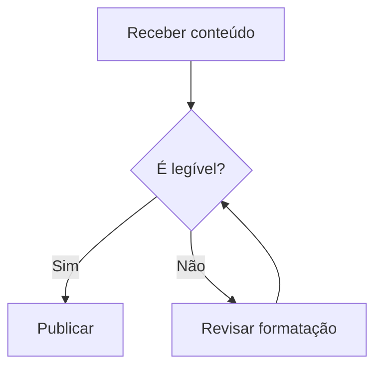
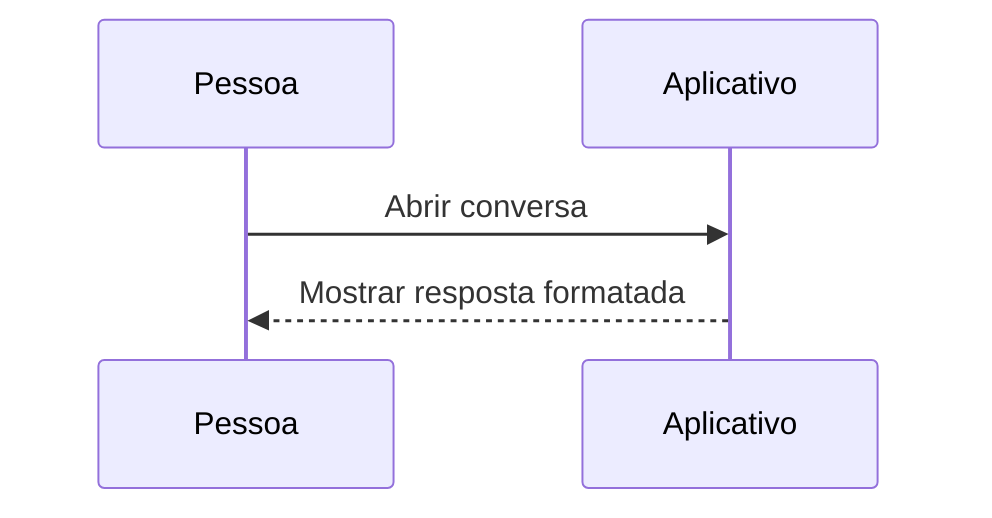

# ✨ Formatação no OpenChamber

Um pequeno mostruário de como organizar mensagens — do texto simples aos blocos de código. Esta fixture reproduz a estrutura da demonstração original e acrescenta os recursos do renderizador de referência. **Não é a fonte exata da resposta original:** o botão de cópia forneceu texto simples.

## 1. Destaques no texto

Você pode usar **negrito para dar ênfase**, *itálico para destacar uma ideia* e ~~texto riscado para indicar algo descartado~~.

Também pode combinar: ***negrito com itálico*** e **um trecho com `código`**.

Para nomes de arquivos, comandos e termos técnicos, use `código em linha`, como `README.md` ou `npm install`. Um identificador longo: `com.exemplo.projeto.identificador_extremamente_longo_para_conferir_a_quebra_no_iPhone`.

Uma quebra suave
continua o mesmo parágrafo. Uma quebra explícita termina aqui.  
Esta linha deve começar abaixo.

---

## 2. Títulos e hierarquia

# Título principal
## Seção
### Subseção
#### Um detalhe dentro da subseção
##### Quinto nível
###### Sexto nível

Os títulos ajudam a dividir um conteúdo longo em partes fáceis de encontrar.

---

## 3. Listas

### Com marcadores

- Uma ideia importante.
- Outra ideia importante.
  - Um detalhe complementar.
  - Mais um detalhe.
    - Terceiro nível com **ênfase**.
- Uma conclusão com texto suficientemente longo para ocupar mais de uma linha e conferir o alinhamento das linhas seguintes.

### Com numeração

1. Entenda o objetivo.
2. Organize as informações.
   1. Separe as fontes.
      1. Confirme os detalhes.
3. Execute o plano.
4. Confira o resultado.

Outra lista, com início explícito:

7. Uma lista que começa no número sete.
8. O próximo número é oito.

### Com tarefas

- [x] Preparar o conteúdo.
- [x] Aplicar diferentes formatações.
- [ ] Escolher sua apresentação favorita.
  - [ ] Conferir uma tarefa aninhada com texto que se estende por mais de uma linha no telefone.

---

## 4. Citações

> “A simplicidade é o último grau de sofisticação.”

Uma citação também pode ter vários parágrafos e destaques:

> **Uma observação importante**
>
> Uma boa apresentação não é apenas bonita: ela facilita a leitura.
>
> > E uma citação pode aparecer dentro de outra.
> >
> > - Uma lista dentro da citação.
> > - Outro item.

---

## 5. Tabelas

| Recurso | Exemplo | Para que serve |
| --- | --- | --- |
| Negrito | **Destaque** | Dar ênfase |
| Itálico | *Observação* | Marcar uma expressão |
| Código | `variavel` | Identificar termos técnicos |
| Riscado | ~~Antigo~~ | Mostrar uma alteração |

**Exemplo com números e alinhamento:**

| Produto | Quantidade | Valor |
| :--- | :---: | ---: |
| Café ☕ | 2 | R$ 18,00 |
| Livro 📚 | 1 | R$ 59,90 |
| **Total** | **3** | **R$ 77,90** |

### Tabela larga e caracteres escapados

| Identificador | Descrição | Responsável | Estado | Observação |
| --- | --- | --- | --- | --- |
| `ios-render-001` | Uma descrição longa que deve quebrar dentro da célula quando a quebra estiver ligada. | Alexandre | ✅ Concluído | A barra escapada \| permanece na mesma célula. |
| `ios-render-002` | Conferir rolagem horizontal sem aumentar a largura da conversa. | Equipe móvel | 🟡 Em andamento | [Documentação](https://www.markdownguide.org) |

---

## 6. Código com destaque de sintaxe

### JavaScript

```javascript
const usuario = {
  nome: "Alexandre",
  tema: "escuro",
  notificacoes: true
};

function darBoasVindas({ nome }) {
  return `Olá, ${nome}! 👋`;
}

console.log(darBoasVindas(usuario));
```

### JSON

```json
{
  "interface": "OpenChamber",
  "mensagem": "Formatação deixa tudo mais claro!",
  "recursos": ["títulos", "listas", "tabelas", "código"]
}
```

### Terminal

```bash
# Uma mensagem simples no terminal
echo "Olá, Alexandre!"
```

### Swift

```swift
struct Projeto: Sendable {
  let nome: String
  let progresso: Double
}

let projeto = Projeto(nome: "Aurora", progresso: 0.7)
print("Progresso: \(projeto.progresso)")
```

### Python

```python
def saudacao(nome: str) -> str:
    return f"Olá, {nome}!"

print(saudacao("Alexandre"))
```

### Texto sem destaque de linguagem

```text
projeto/
├── src/
│   ├── componentes/
│   └── paginas/
├── testes/
└── README.md
```

### Linha longa e linguagem desconhecida

```linguagem-inexistente
Esta linha propositalmente longa verifica a quebra, a numeração da linha original e a alternativa de rolagem horizontal sem alterar o conteúdo copiado nem truncar a informação apresentada.
```

---

## 7. Links

Um link pode aparecer com um texto descritivo:

[Conheça a documentação do Markdown no GitHub](https://docs.github.com/pt/get-started/writing-on-github).

Ou diretamente: https://www.markdownguide.org e <https://example.com/caminho?origem=markdown>.

Autolink GFM: www.example.com. E-mail: <alexandre@example.invalid>.

---

## 8. Caracteres e símbolos

Status: ✅ Concluído · 🟡 Em andamento · ❌ Falhou · ⏸️ Pausado

Direções: ← → ↑ ↓ ↔

Símbolos: ✓ ✗ ★ ☆ © ® ™ ± ≠ ≤ ≥ ∞

Progresso ilustrativo: `███████░░░ 70%`

Emoji Unicode: 🚀 👩🏽‍💻 🇧🇷 ☕. Um shortcode não deve ser expandido: :smile:.

---

## 9. Mostrar a própria formatação

Use uma barra invertida para mostrar os caracteres sem aplicar o efeito:

\*\*Isso não fica em negrito\*\*

\*Isso não fica em itálico\*

Ou coloque a marcação dentro de um bloco:

```markdown
# Meu título

Um texto com **negrito**, *itálico* e `código`.

- Primeiro item
- Segundo item

> Uma observação.
```

---

## 10. Tudo junto: um resumo de projeto

### 🚀 Projeto Aurora

**Objetivo:** deixar a experiência de leitura mais clara e agradável.

**Situação:** 🟡 Em andamento  
**Responsável:** Alexandre  
**Próxima entrega:** revisão visual

| Etapa | Situação |
| --- | --- |
| Planejamento | ✅ Concluído |
| Desenvolvimento | ✅ Concluído |
| Revisão | 🟡 Em andamento |
| Publicação | ⏳ Pendente |

**Próximos passos:**

1. Revisar os textos.
2. Conferir a apresentação em telas pequenas.
3. ~~Adicionar mais elementos decorativos.~~ **Priorizar clareza.**

---

*Uma boa formatação orienta o olhar.* **O conteúdo continua sendo o protagonista.**

## 11. Notas de rodapé

Uma afirmação com uma nota explicativa[^clareza] e uma segunda referência à mesma nota[^clareza]. Outra nota contém um link[^fonte].

[^clareza]: A clareza depende de **hierarquia**, contraste e espaçamento.

[^fonte]: Consulte o [guia de Markdown](https://www.markdownguide.org).

## 12. Matemática

Uma expressão em linha: $E = mc^2$. Outra expressão: \(a^2 + b^2 = c^2\).

A soma em destaque:

$$
\sum_{k=1}^{n} k = \frac{n(n+1)}{2}
$$

\[
\int_0^1 x^2\,dx = \frac{1}{3}
\]

Uma matriz:

$$
\begin{pmatrix} a & b \\ c & d \end{pmatrix}
$$

Moeda não é matemática: $100$, $5 e $10; R$ 18,00. Delimitadores dentro de código também não: `$x^2$`.

## 13. Diagramas Mermaid





## 14. Conteúdo recolhível

<details>
<summary>Ver os detalhes da revisão</summary>

Este conteúdo começa **recolhido** e mantém Markdown.

- Conferir a hierarquia.
- Testar a cópia e a seleção.

<details>
<summary>Um detalhe aninhado</summary>

Texto interno com `código` e [link](https://example.com).

</details>

</details>

<details open>
<summary>Resumo aberto inicialmente</summary>

Este conteúdo começa visível.

</details>

## 15. Imagens

![Cartão abstrato do Projeto Aurora](data:image/png;base64,iVBORw0KGgoAAAANSUhEUgAAAtAAAADwCAIAAACmBsTUAAAFYUlEQVR4nO3WQQ1oRRZF0a/jS2gJCGDYgzaABTwggQQ/7YwBCsjLrpOqrGQJuKN79o+f//kFACD1Y34BAPA8wQEA5AQHAJATHABATnAAADnBAQDkBAcAkBMcAEBOcAAAOcEBAOQEBwCQExwAQE5wAAA5wQEA5AQHAJATHABATnAAADnBAQDkBAcAkBMcAEBOcAAAOcEBAOQEBwCQExwAQE5wAAA5wQEA5AQHAJATHABATnAAADnBAQDkBAcAkBMcAEBOcAAAOcEBAOQEBwCQExwAQE5wAAA5wQEA5AQHAJATHABATnAAADnBAQDk2uD43x+/AQD/1rwPBAcAvG/eB4IDAN437wPBAQDvm/eB4ACA9837QHAAwPvmfSA4AOB98z4QHADwvnkfCA4AeN+8DwQHALxv3geCAwDeN+8DwQEA75v3geAAgPfN+0BwAMD75n0gOADgffM+EBwA8L55HwgOAHjfvA8EBwC8b94HggMA3jfvA8EBAO+b94HgAID3zftAcADA++Z9IDgA4H3zPhAcAPC+eR8IDgB437wPBAcAvG/eB4IDAN437wPBAQDvm/eB4ACA9837QHAAwPvmfSA4AOB98z4QHADwvnkfCA4AeN+8DwQHALxv3geCAwDeN+8DwQEA75v3geAAgPfN+0BwAMD75n0gOADgffM+uCw4AAB+Cg4A4ADBAQDkBAcAkBMcAEBOcAAAOcEBAOQEBwCQExwAQE5wAAA5wQEA5AQHAJATHABATnAAADnBAQDkBAcAkBMcAEBOcAAAOcEBAOQEBwCQExwAQE5wAAA5wQEA5AQHAJATHABATnAAADnBAQDkBAcAkBMcAEBOcAAAOcEBAOTa4Pjv738CvG3+x+EKggPgk/kfhysIDoBP5n8criA4AD6Z/3G4guAA+GT+x+EKggPgk/kfhysIDoBP5n8criA4AD6Z/3G4guAA+GT+x+EKggPgk/kfhysIDoBP5n8criA4AD6Z/3G4guAA+GT+x+EKggPgk/kfhysIDoBP5n8criA4AD6Z/3G4guAA+GT+x+EKggPgk/kfhysIDoBP5n8criA4AD6Z/3G4guAA+GT+x+EKggPgk/kfhysIDoBP5n8criA4AD6Z/3G4guAA+GT+x+EKggPgk/kfhysIDoBP5n8criA4AD6Z/3G4QhscAAA/BQcAcIDgAAByggMAyAkOACAnOACAnOAAAHKCAwDICQ4AICc4AICc4AAAcoIDAMgJDgAgJzgAgJzgAAByggMAyAkOACAnOACAnOAAAHKCAwDICQ4AICc4AICc4AAAcoIDAMgJDgAgJzgAgFwbHP//61cA+Md88xgSHAAcMt88hgQHAIfMN48hwQHAIfPNY0hwAHDIfPMYEhwAHDLfPIYEBwCHzDePIcEBwCHzzWNIcABwyHzzGBIcABwy3zyGBAcAh8w3jyHBAcAh881jSHAAcMh88xgSHAAcMt88hgQHAIfMN48hwQHAIfPNY0hwAHDIfPMYEhwAHDLfPIYEBwCHzDePIcEBwCHzzWNIcABwyHzzGBIcABwy3zyGBAcAh8w3jyHBAcAh881jqA0OAICfggMAOEBwAAA5wQEA5AQHAJATHABATnAAADnBAQDkBAcAkBMcAEBOcAAAOcEBAOQEBwCQExwAQE5wAAA5wQEA5AQHAJATHABATnAAADnBAQDkBAcAkBMcAEBOcAAAOcEBAOQEBwCQExwAQE5wAAA5wQEA5AQHAJATHABATnAAADnBAQDkBAcAkBMcAEBOcAAAOcEBAOQEBwCQExwAQE5wAAA5wQEA5AQHAJATHABATnAAADnBAQDkBAcAkBMcAEBOcAAAOcEBAOQEBwCQExwAQE5wAAA5wQEA5AQHAJATHABATnAAADnBAQDkBAcAkBMcAEBOcAAAOcEBAOQEBwCQExwAQE5wAAA5wQEA5AQHAJATHABATnAAADnBAQDkBAcAkBMcAEBOcAAAOcEBAOQEBwCQExwAQE5wAAA5wQEA5AQHAJD7G8AeTek1cNmaAAAAAElFTkSuQmCC)

## 16. Limites intencionais da referência

HTML geral não é ativado no chat. Teclas permanecem literais: <kbd>⌘</kbd> + <kbd>C</kbd>. Uma alternativa em código: `⌘` + `C`.

> [!NOTE]
> OpenChamber não tem um renderizador especial de alertas GitHub; esta marcação continua sendo uma citação comum.

Não há plugin de destaque: ==isto não recebe realce especial==. A forma HTML também é literal: <mark>realce</mark>.

**Fim da fixture de formatação.**
